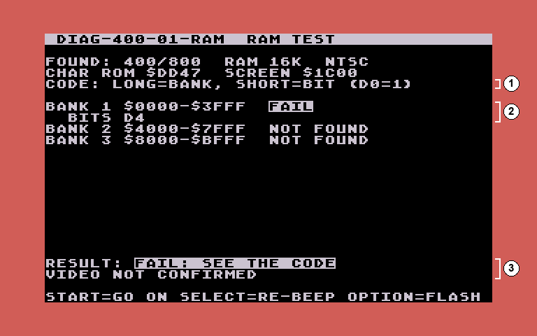
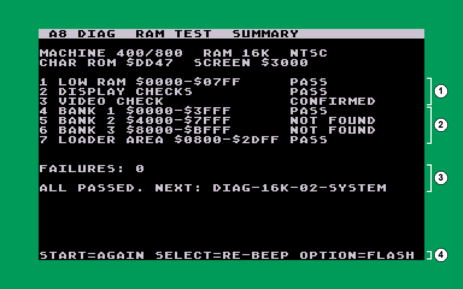
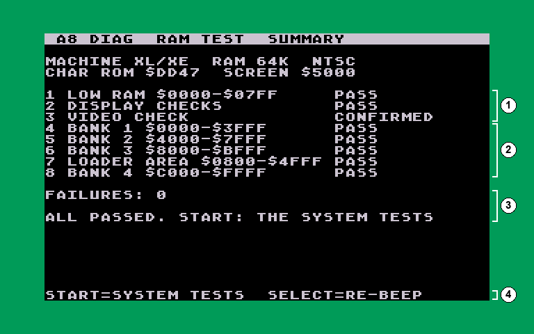
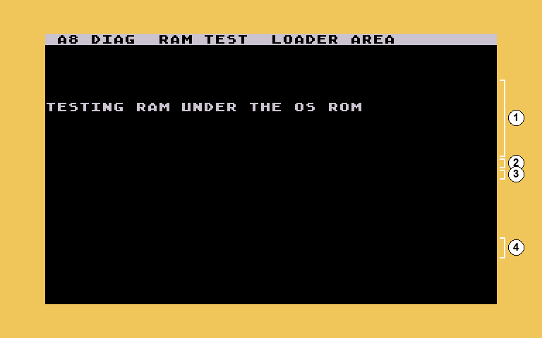
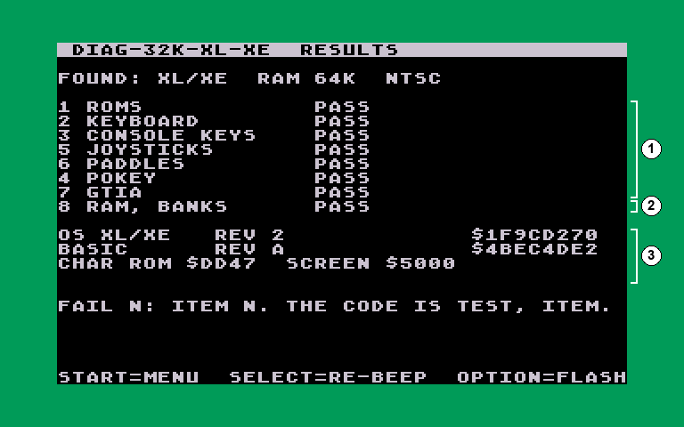
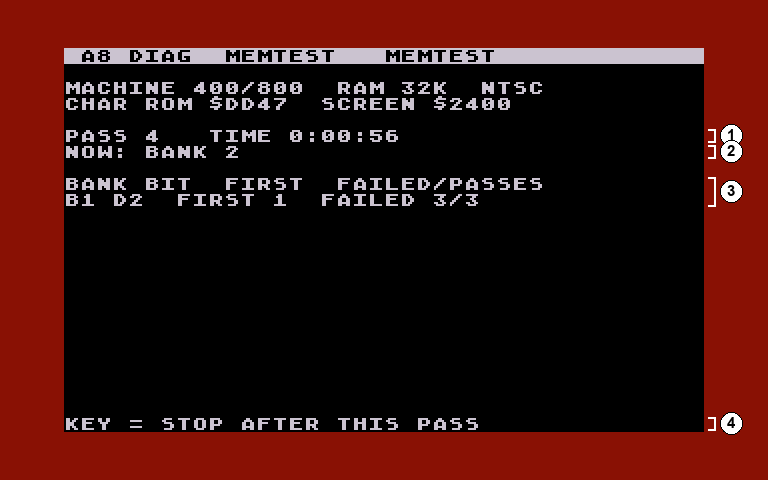
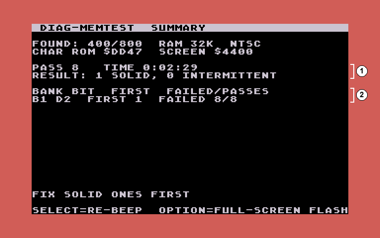
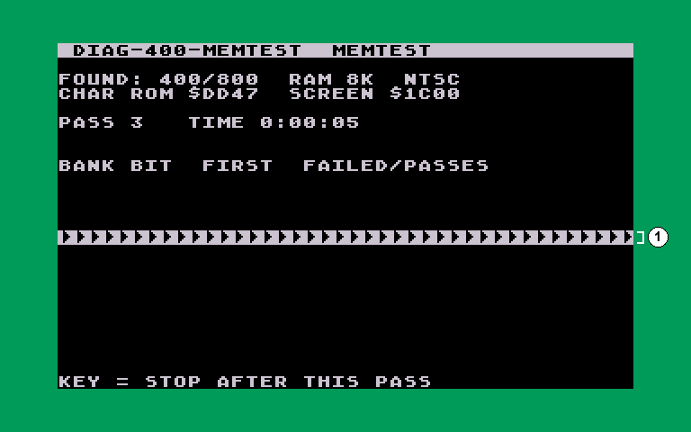

# A8 Cassette Diagnostics: User Guide

Version 0.1.1

These tapes test an Atari 400, 800, XL or XE. You load them like any
cassette program. They tell you what works and what doesn't, by colour and
by beeps first, and with text on screen once the screen itself has been
checked. So they're still useful when the picture is bad.

You don't need to know any programming. You need the `.cas` files from the
`cassettes` folder and a way to play them into the machine (see
[Loading a tape](#loading-a-tape)).

Pictures in this guide come from the project's simulator, using the MiSTer
Atari800 core's NTSC palette and a real Atari OS font. The colours and
their RGB values are what the MiSTer core shows; a real TV or monitor may
differ a little.

## Contents

1. [Why cassette, and why several sets](#why-cassette-and-why-several-sets)
2. [Which tapes for which machine](#which-tapes-for-which-machine)
3. [Loading a tape](#loading-a-tape)
4. [Reading the results: the screen, colours, beeps, keys](#reading-the-results)
5. [The tapes, screen by screen](#the-tapes-screen-by-screen)
6. [When something fails](#when-something-fails)
7. [Questions](#questions)

## Why cassette, and why several sets

**Cassette, because it needs the least of the machine.** A cassette boot
needs only the computer, its OS ROM, the first few K of RAM and the SIO
port. There's no disk drive to work, no DOS to load, and nothing else for
the tape to depend on. So it runs on the smallest machine there is, a 400
with 8K, and on a machine too sick to boot a disk. Each tape loads into the
bottom of RAM and tests everything else from there.

**A disk version is planned.** It will load much faster, for machines with a
working disk drive. The cassette tapes stay as the version for low-spec and
failing machines.

**Several sets, because tape is slow.** A cassette loads at 600 baud: about
3K a minute. So every tape is as small as it can be, and how you split the
tests depends on how much RAM the machine has:
- A **400 with 8K** gets five small tapes of about 2 minutes each. Each fits
  in 8K and needs only what the tapes before it have tested.
- A machine with **16K** loads two bigger tapes, about 3 minutes each.
- An **800 with 32K or 48K, or any XL or XE**, loads one tape of about 6
  minutes that does everything, RAM test included.

Within each set, every tape only relies on what an earlier one proved. For
example, RAM is tested before anything else runs from it, and the keyboard
is tested before a test asks you a yes/no question.

## Which tapes for which machine

| Your machine | Use these tapes, in this order |
|---|---|
| 400 with 8K | `diag-400-01-ram`, `-02-rom`, `-03-input`, `-04-ports`, `-05-av`; for a long test, `diag-400-memtest` |
| 400 or 800 with 16K | `diag-16k-01-ram`, `diag-16k-02-system`; for a long test, `diag-memtest` |
| 800 with 32K or 48K, any XL or XE | `diag-32k-xl-xe` (one tape does it all); for a long test, `diag-memtest` |
| **any machine that won't get through its own set** | **the 400 set**: it only needs the first 8K of RAM to work |
| keyboard, joysticks and paddles only (16K and up) | `diag-controls` |

Not sure how much RAM there is? Start with `diag-400-01-ram`: it measures
the RAM and shows it on screen.

All the tapes:

| Tape | Load time | Needs | Tests |
|---|---|---|---|
| `diag-400-01-ram` | 2 min, then 1.5 min for part 2 | 8K | the video check and all the RAM; part 2 (16K and up) the RAM the tape itself used, the RAM under an XL/XE's OS and a 130XE's extra RAM |
| `diag-400-02-rom` | 2 min | 8K | test 1, the ROMs |
| `diag-400-03-input` | 2 min | 8K | tests 2 and 3, the keyboard and the console keys |
| `diag-400-04-ports` | 2 min | 8K | tests 5 and 6, the joysticks and the paddles |
| `diag-400-05-av` | 2 min | 8K | tests 4 and 7, the sound (POKEY) and the video (GTIA) |
| `diag-400-memtest` | 2 min | 8K | the memory test, until you stop it |
| `diag-16k-01-ram` | 3.5 min | 16K | the RAM test in one load, the tape's own RAM included |
| `diag-16k-02-system` | 3.5 min | 16K | tests 1-7, with a menu |
| `diag-32k-xl-xe` | 6 min | 32K | the whole RAM test, then tests 1-7 with a menu, in one load |
| `diag-memtest` | 2.5 min | 16K | the memory test, until you stop it |
| `diag-controls` | 2 min | 16K | the keyboard, joystick and paddle tests only |

`diag-controls` is a companion to Atari's SALT diagnostic disks: their
controller tests need a test harness plugged in, and this tape doesn't.

`diag-400-01-ram-part2` is the second part of the 400 RAM tape as a file of
its own. A 400 with 8K never loads it; a bigger machine running the 400 set
does. You only need it with a player that can't wait between the two parts
(see [AspeQt](#from-a-pc-usb-sio-interface-and-aspeqt)).

## Loading a tape

### Starting the machine for a cassette boot

1. Turn the Atari off.
2. **Take out any cartridge**, BASIC included. A cartridge covers 8K of RAM,
   so the RAM test can't reach it; the `FOUND:` line then says `CART IN`.
   An XL or XE's built-in BASIC doesn't matter: the tapes switch it off
   themselves.
3. Hold **START** and turn the Atari on, still holding START. It beeps once.
4. Start the tape, then press any key on the Atari.

When the tape has loaded, the border turns green and you hear a rising
chirp: the machine is running the test.

### On a MiSTer (Atari800 core)

Put the `.cas` files on the MiSTer's storage (for example in
`games/ATARI800/_diag`). Load the tape in the core's menu, then do the
cassette boot above.

### From a PC: USB-SIO interface and AspeQt

A USB-to-SIO interface (an "SIO2PC" cable; for example the SIO2PC-USB) plugs
into the Atari's SIO port (the one the disk drive and cassette recorder use)
and into a PC's USB port. On the PC it shows up as a COM port. The free
program [AspeQt](https://sourceforge.net/projects/aspeqt/) can then play a
`.cas` file into the Atari as if it came from a cassette recorder.

Setting up AspeQt (Tools > Options):
- **Serial port:** the COM port the interface uses (Windows Device Manager
  shows it).
- **Handshake:** the method your interface uses (its manual says which).
- **Cassette speed:** leave "Use custom baud rate for cassette emulation"
  off: the tapes are 600 baud, the normal speed.

AspeQt's manual recommends interfaces built on an FTDI USB chip, and says
the AtariMax "SIO2PC Universal Interface USB Edition" isn't supported.

To play a tape:
1. In AspeQt, choose **File > Playback cassette image** and pick the `.cas`
   file (or drag the file onto AspeQt). A dialog with instructions appears.
2. Do the cassette boot on the Atari (hold START, power on, wait for the
   beep).
3. Press a key on the Atari and confirm AspeQt's dialog at about the same
   time. The tape plays.

AspeQt can't rewind or pause a tape. On a machine with 16K or more,
`diag-400-01-ram` is a **two-part tape**: the first part runs its RAM test
for a few minutes before it asks for part two, and by then AspeQt has
played past it. The screen then says `STAGE 2: NOT ON TAPE` or `ERROR`.
When that happens, play `diag-400-01-ram-part2.cas` and press START on the
Atari: it tries again. Every other tape is a single part and doesn't have
this problem.

### From a real cassette recorder

The `.cas` files can be turned into audio (a `.wav` file) with a CAS-to-WAV
converter, and the audio recorded onto a tape for an Atari 410 or 1010
recorder. This hasn't been tried with these tapes yet.

## Reading the results

### The top of every screen

The bar along the top names **the tape** you loaded, then the test on
screen: for example `DIAG-16K-02-SYSTEM  2 KEYBOARD`. That's the tape's
name, not what it found out about your machine.

What the tape **found** is on the line below it: `FOUND:`, then the machine
type (400/800 or XL/XE), all the RAM it found (an 800XL shows 64K, a 130XE
128K), PAL or NTSC, and `CART IN` if a cartridge is plugged in. So the
32k+ tape on an 800 with 48K shows `DIAG-32K-XL-XE` on top and
`FOUND: 400/800  RAM 48K  NTSC` below.

### Colours

The border colour tells you what's happening, even when the picture is
unreadable or the screen is switched off:

| | Colour | RGB (MiSTer NTSC) | Meaning |
|---|---|---|---|
|  | green | `#009B58` | alive (just after loading); everything passed |
|  | bright green flash | `#4CE5AB` | a pass beep: the jingle, then one long flash per RAM bank or test that passed |
|  | yellow | `#F0C55A` | testing. If it stays yellow and silent, the machine hung in that test. Memory test: an intermittent fault has been seen |
|  | red | `#891104` | a fault; the beep code follows |
|  | bright red flash | `#D15D57` | a fault beep (see the beep code below) |
|  | purple | `#AD3C9F` | waiting for you: a question to answer, or the video check's last chance |
| | black | `#000000` | the short gap between two flashes, and the moment after you answer a question |

On the text screens the text is light grey (`#CBC3D0`) on black.

You never need colour to read a result: every colour comes with a sound,
and on a working screen with text as well.

### The beep code

Every flash comes with a beep, so you can read the code by eye or by ear.

| Sound | Flash | Meaning |
|---|---|---|
| rising three-note jingle | bright green | a pass |
| long beep (about 0.6 s, 440 Hz) | bright red | group A: **where**, counted. The RAM bank (1-4; the 130XE's extra banks are 5-8), or the test number |
| short beep (about 0.2 s, 880 Hz) | bright red | group B: **what**, counted. For RAM, the data bit, D0 = 1 up to D7 = 8; for a test, the item |
| low beep (about 0.6 s, 220 Hz) | bright red | the end of the list |

A fault plays as: long beeps (where), a pause, short beeps (what), and so
on for each bad bit or item, then the low end beep. Then the border holds
steady red for 3 s and the code plays again.

Example: **long, long, pause, short ×5, low** = bank 2, bit D4.

A single long beep then the low beep, with no short beeps and no picture,
means the tape didn't load correctly into RAM (a bad image checksum): see
[When something fails](#when-something-fails).

The test numbers are the same on every tape: 1 ROMs, 2 keyboard, 3 console
keys, 4 POKEY, 5 joysticks, 6 paddles, 7 GTIA. On `diag-32k-xl-xe`, 8 is
the RAM.

### Keys during a result

| Key | Does |
|---|---|
| START, any key, or a joystick button | go on |
| SELECT | play the beep code again |
| OPTION | switch between the text screen and full-screen flashes (the whole screen flashes with the code: easier to see when the picture is garbled) |

A test that passes moves on by itself after about 2 seconds, except the ROM
test, which waits so you can read the names and checksums. At the end of a
tape the results stay up until you press START:
- the 400 tapes 02-05 and `diag-controls`: START runs that tape's tests again
- the menu tapes (`diag-16k-02-system`, `diag-32k-xl-xe`): START goes back to
  the menu
- `diag-16k-01-ram`: START runs the whole RAM test again
- `diag-32k-xl-xe`'s RAM summary: START goes on to the system tests

After the opening video check, no question has a time limit: every question
waits until you answer it, with a purple border, and a test that asks about
a sound keeps playing it until you answer.

## The tapes, screen by screen

### RAM test (`-01-ram`, and the start of `diag-32k-xl-xe`)

**Video check.** First the tape checks that the screen works.

1. The question. If you can read it and see eight colour bars, press any
   key or the joystick button.
2. Seconds left. With no answer the border turns purple, a siren sounds for
   a moment and a 10 s last chance starts. Without an answer the test goes
   on anyway, and the results say `VIDEO NOT CONFIRMED`.
3. The whole character set, normal and inverse.
4. What the tape found (the machine, all its RAM, PAL or NTSC), a checksum
   of the character ROM, and where the screen is in RAM.
5. The eight colour bars.

**Testing.** Each 16K bank is tested in turn; the screen says which. On a
machine with a lot of RAM this takes a few minutes.

1. What the tape found.
2. The bank being tested now.

**Result** (the 400 tape; the 16K and 32K tapes go straight on to the
summary below).

1. How to read the code.
2. One line per 16K bank: PASS, FAIL, or NOT FOUND (no RAM there).
3. The overall result.
4. The keys (see [Keys during a result](#keys-during-a-result)).

When a bank fails, its line shows the bad data bits:

1. How to read the code.
2. The failed bank and its bad bits. On an 800XL each data bit is one RAM
   chip; see [When something fails](#when-something-fails).
3. The overall result, and `VIDEO NOT CONFIRMED` when nobody answered the
   video check. The border is red while the code plays: here long ×1
   (bank 1), short ×5 (bit D4).

**Summary** (machines with 16K or more). Next the tape tests the RAM it
ran in itself (the "loader area"), then on an XL/XE the RAM under the
operating system and, on a 130XE, the four extra banks. Then it shows
everything. On the 400 tape the second part does this:

1. Low RAM, the display checks and the video check.
2. Every bank, and the area the tape itself ran in. On an XL/XE also the RAM
   under the OS, and on a 130XE the extra banks.
3. The number of failures and the next tape.

On `diag-16k-01-ram` it's all one load: the tape tests its own RAM page by
page, moving each page into the screen (the top rows show a jumble for a
moment), testing it and putting it back. The summary waits for you:

1. Low RAM, the display checks and the video check.
2. Every bank, and the area the tape itself ran in.
3. The number of failures and the next tape. A failure shows its first bad
   address and bits, with a hint (one bit: one RAM chip).
4. START runs the whole RAM test again.

### ROMs (`diag-400-02-rom`; test 1 on the system tapes)

The test reads every ROM chip and works out its CRC32 checksum, then looks
it up in a table of known Atari ROMs.

1. The 400/800's three OS chips, each named on its own, with its CRC32. A
   repaired board can have chips from different revisions; the test spots
   that (item 5).
2. A cartridge, if one is plugged in (here BASIC rev A, which is also why
   the `FOUND:` line says `CART IN` and only 40K of RAM). `NONE` is not a
   fault.
3. The character set's checksum.
4. The result. The ROM test waits here until you press a key, so you can
   read the names.

On an XL/XE the OS is one 16K chip, named as a whole:

1. The OS. `UNKNOWN` (in inverse) means it matches no Atari ROM in the
   table: a patched, replacement, failing or badly seated chip.
2. BASIC, built into the XL/XE. A BASIC or cartridge the table doesn't know
   shows `NOT IN THE TABLE` and is not a fault.
3. The character set's checksum.
4. The result.

The names come from published tables of Atari's own ROMs (see
[DEVELOPMENT.md](DEVELOPMENT.md)), not from any one machine.

Items: 1 the OS reads differently twice; 2 BASIC or the cartridge reads
differently twice; 3 an unknown OS; 4 the character set reads differently
twice; 5 OS chips from different revisions.

### Keyboard and console keys (`diag-400-03-input`; tests 2 and 3)

**Keyboard.** Press every key. Each key on the map shows one of three
states, without needing colour, so this works on a black-and-white screen
too:

1. The key map. Not pressed yet: normal. Done: inverse. Held down now:
   inverse, blinking. The four arrow keys are CONTROL with `-` `=` `+`
   `*`, so those keys carry the arrows. CONTROL lights only together with
   another key: the Atari can't see CONTROL on its own.
2. The legend.
3. How many keys are left. HELP and F1-F4 (XL/1200XL) show but aren't
   required.

Press START when you're done. If keys are missing, the result screen shows
the pressed keys in inverse, so the missing ones stand out:

1. The map: inverse = pressed, normal = never pressed.
2. The legend for this screen.
3. Keys left.
4. The result and the failed items (item 1: a key was already held at the
   start, a stuck key; item 2: keys never pressed).
5. The keys.

**Console keys.** Press START, SELECT and OPTION. Then the console speaker
plays a tone over and over until you answer.

1. What to do. If one of the three keys is dead, any keyboard key moves on
   (and that key is marked failed).
2. The keys seen so far, in inverse.
3. The question about the speaker, answered with Y or START (yes) or N or
   SELECT (no). The border is purple while it waits.

### Joysticks and paddles (`diag-400-04-ports`; tests 5 and 6)

**Joysticks.** Move each joystick and press its button. Each direction and
the button show inverse while active. START (or any key) ends the test.

1. One line per port: four on a 400/800, two on an XL/XE. Something
   already active at the start counts as stuck (item = port).

**Paddles.** First, unplug all paddles and press START: with nothing
plugged in, every paddle input must read 228 (SELECT skips this check).
Then plug the paddles back in and turn each one. START or any key ends the
test.

1. What to do. SELECT switches the fast scan on and off.
2. The column headings: the value now, the lowest and highest seen (a full
   turn reaches about 1 and 228), and the jitter.
3. One line per paddle, with a bar. Here nothing is plugged in, so every
   one reads 228. Jitter is how much the value wobbles with the knob
   still: a large jitter means a dirty or worn paddle. A `T` at the end
   means the paddle's button is pressed.

### Sound and video (`diag-400-05-av`; tests 4 and 7)

**POKEY.** The sound chip's timer and random-number generator are checked
automatically. Then each of its four voices plays, one at a time, over and
over until you answer whether you heard it.

1. The automatic checks are done.
2. The voice playing now.
3. The question: Y or START = yes, N or SELECT = no.

**GTIA.** First, eight brightness steps and sixteen colours, drawn down the
screen (item 1). Then the sprites (item 2): the word ATARI, made of the four
players and the four missiles, scrolls across the screen in rainbow colours
that move down the letters. Answer whether each looks right.

1. PAL or NTSC, as the machine reports it.
2. Eight even steps from black to white.
3. Sixteen different colours.
4. The question: do they look right?

### The menu (`diag-16k-02-system` and `diag-32k-xl-xe`)

On machines with 16K or more, all seven tests are on one tape, with a
menu.

1. The tests, with their state: `-` not run yet, PASS, or FAIL and the
   failed items. They're listed in the order they run, which is why 5 and
   6 come before 4.
2. `ALL OF THEM, IN ORDER`, highlighted when the menu first appears: one
   press of START runs everything.
3. The results and the final code.
4. The keys: START runs the highlighted line, SELECT moves down, OPTION
   moves up, and the number keys run that test. After a test the next one
   is highlighted, so pressing START again and again goes through them
   all.

Running a test again replaces its old result.

1. Every test: PASS, FAIL and its items, or `-` if not run.
2. The ROMs (see [ROMs](#roms-diag-400-02-rom-test-1-on-the-system-tapes)).

### The 32K and XL/XE tape (`diag-32k-xl-xe`)

One tape, one load, for an 800 with 32K or 48K and every XL and XE:
1. The RAM test: everything above the program gets the full test.
2. The program's own RAM, page by page: each page is moved into the screen
   (the top rows show a jumble for a moment), tested, and put back.
3. On an XL/XE: the RAM under the OS and, on a 130XE, the four extra banks.
4. The RAM summary, which waits for you:

1. Low RAM, the display checks and the video check.
2. Every bank, the area the tape ran in, and here (an XL) the RAM under the
   OS as bank 4.
3. The result and what's next.
4. START goes on to the system tests.

5. The seven tests, with the menu:

1. The tests.
2. All of them, in order.
3. The results.
4. `0 RAM TEST AGAIN`: the whole RAM test from the start, with the RAM
   result so far beside it. Choose it with SELECT and START, or press 0.
   After the RAM summary, START brings you back to this menu, with the
   other tests cleared to `-`.
5. The keys.

At the end, RAM faults show up again as test 8, with the bank as the item:

1. The seven tests.
2. Test 8: the RAM. FAIL with the bank numbers if any RAM failed; the code
   plays them as long ×8, then short × bank.
3. The ROMs: here a real XL OS rev 2 and BASIC rev A.

During the ROM test the screen goes blank for about a third of a second:
the test is reading the XL/XE's self-test ROM, which sits where this tape
keeps its screen.

### Controls only (`diag-controls`)

The keyboard, joystick and paddle tests from above, on one tape for 16K
and up, with nothing else: no menu, no RAM or ROM test. They run in order,
and at the end START runs them again. Use it alongside Atari's SALT
diagnostic disks, whose controller tests need a test harness.

### Memory test (`diag-memtest`, `diag-400-memtest`)

The memory test (a burn-in) repeats the RAM tests until you press a key:
leave it running for an hour or a day to catch faults that only show when
the machine is warm. It keeps a clock, counts passes, and logs every bad
bit: in which pass it first failed, and in how many passes since. A bit
that failed every time is **solid**; one that only fails sometimes is
**intermittent**.

1. The pass number and how long it has run.
2. What it's testing now.
3. The log: bank (B1-B8; B9 is the memory test's own RAM, when it tests it
   page by page), bit, the first pass it failed in, and failed/passes.
4. Press a key (or START, SELECT, OPTION or a joystick button) to stop
   after the pass in progress.

The border shows the state so far: green no errors, red solid errors only,
yellow if anything intermittent has been seen.

1. Passes, time and the result.
2. The log.

The memory test also tests the RAM it runs in:
- **`diag-400-memtest`**, and **`diag-memtest` on 16K:** each page of its
  own code is moved aside, tested and put back, every pass. While that
  happens the top of the screen shows the page being worked on, as a
  jumble of characters.
- **`diag-memtest` on 32K and up:** it keeps two copies of itself that take
  turns, each testing the other's RAM. So the RAM it sits in gets the same
  full test as all the rest.

Every pass, both memory tests also test the screen's own RAM where you can see
it: an inverse bar runs down the screen, one row at a time. Each row is
inverted, held for two frames, checked, put back and checked again.

1. The row being tested. A blank row shows as a row of arrows: that's what
   a space looks like with every bit flipped.

## When something fails

- **Note the code** (or the screen). Long beeps say where, short beeps say
  which bit or item.
- **RAM:** a bad bit in one bank usually means one RAM chip. On an 800XL
  each data bit (D0-D7) is one chip, across all of the 64K. On a 400/800
  each 16K board has its own chips, so the bank tells you which board. The
  same bad bit in every bank points at something shared: a data line, a
  socket, or a buffer chip.
- **Run the memory test** on a machine that passes but misbehaves, or after a
  repair. Intermittent faults often only show when the machine is warm.
- **Fall back to the 400 set** when a machine can't get through its own
  tapes. It only needs the first 8K of RAM. In particular:
  - no green chirp after loading: the RAM the tape loaded into is bad
  - one long beep then the low beep, with no picture: the tape didn't load
    into RAM correctly
  - `BANK 1 BAD: USE THE 400 SET`
- **A tape that won't load at all**, or a BOOT ERROR, also points at the
  first part of RAM, or the cassette or SIO connection.

## Questions

### Why the different sets?

So that a tape never needs more RAM than the machine has, and bigger
machines load in fewer, longer steps. Tape is slow, so loading the fewest
bytes matters. The 400 set works on everything, which is why it's the
fallback. See [Why cassette, and why several sets](#why-cassette-and-why-several-sets).

### Why not a disk?

A disk needs a working drive and more of the machine before anything can
run. The cassette tapes are for the machines that can't manage that: an
8K 400, or a machine that fails to boot a disk. A disk version is planned,
for faster loading on machines that have a drive.

### Is this a substitute for the memory test?

No. The RAM tapes test every byte with strong patterns, but only once. A
fault that only shows when warm, or now and then, needs the memory test
running for a while.

### Does a pass prove the machine is good?

It proves what was tested: RAM, ROMs, the keyboard, the console keys, the
controller ports, and the sound and video chips as far as you could see
and hear them. The SIO port gets a workout just by loading the tape. It
doesn't test a disk drive, a printer, or the cartridge slot beyond naming
a cartridge that's plugged in.
