# A8 Cassette Diagnostics: User Guide

These tapes test an Atari 400, 800, XL or XE. You load them like any
cassette program. They tell you what works and what doesn't, by colour and
by beeps first, and with text on screen once the screen itself has been
checked. So they're still useful when the picture is bad.

You don't need to know any programming. You need the `.cas` files from the
`cassettes` folder and a way to play them into the machine (see
[Loading a tape](#loading-a-tape)).

Pictures in this guide come from the project's simulator, using the MiSTer
Atari800 core's NTSC palette and a real Atari OS font. The colours and
their RGB values are what the MiSTer core shows; a real TV or monitor may
differ a little.

## Contents

1. [Which tapes for which machine](#which-tapes-for-which-machine)
2. [Loading a tape](#loading-a-tape)
3. [Reading the results: colours, beeps, keys](#reading-the-results)
4. [The tapes, screen by screen](#the-tapes-screen-by-screen)
5. [When something fails](#when-something-fails)
6. [Questions](#questions)

## Which tapes for which machine

| Your machine | Use these tapes, in this order |
|---|---|
| 400 with 8K | `diag-400-01-ram`, `-02-rom`, `-03-input`, `-04-ports`, `-05-av`, and for a long test `diag-400-burnin` |
| 400 or 800 with 16K or 32K | `diag-16k-01-ram`, `diag-16k-02-system`, and `diag-burnin` |
| 800 with 48K, any XL or XE | `diag-48k-xl-xe` (one tape does it all), and `diag-burnin` |
| **any machine that won't get through its own set** | **the 400 set**: it only needs the first 8K of RAM to work |
| keyboard, joysticks and paddles only (16K and up) | `diag-controls`: just those three tests, no harness needed. A companion to Atari's SALT diagnostic disks, whose controller tests need a test harness |

Not sure how much RAM there is? Start with `diag-400-01-ram`: it measures
the RAM and shows it on screen.

Each set is ordered so that every tape relies only on what the earlier ones
proved. For example, RAM is tested before anything else runs from it, and
the keyboard is tested before a test asks you a yes/no question.

The `-part2` files are the second half of a two-part tape on its own. You
only need them with a player that doesn't stop between the parts (see
[AspeQt](#from-a-pc-usb-sio-interface-and-aspeqt)).

## Loading a tape

### Starting the machine for a cassette boot

1. Turn the Atari off.
2. Hold **START**. On an XL or XE, hold **START and OPTION** (OPTION keeps
   BASIC out of the way).
3. Turn the Atari on, still holding the keys. It beeps once.
4. Start the tape, then press any key on the Atari.

Loading takes from about one minute (the small 400 tapes) to six minutes
(the 48k+ tape). When it's loaded, the border turns green and you hear a
rising chirp: the machine is running the test.

### On a MiSTer (Atari800 core)

Put the `.cas` files on the MiSTer's storage (for example in
`games/ATARI800/_diag`). Load the tape in the core's menu, then do the
cassette boot above.

### From a PC: USB-SIO interface and AspeQt

A USB-to-SIO interface (an "SIO2PC" cable; for example the SIO2PC-USB) plugs
into the Atari's SIO port (the one the disk drive and cassette recorder use)
and into a PC's USB port. On the PC it shows up as a COM port. The free
program [AspeQt](https://sourceforge.net/projects/aspeqt/) can then play a
`.cas` file into the Atari as if it came from a cassette recorder.

Setting up AspeQt (Tools > Options):
- **Serial port:** the COM port the interface uses (Windows Device Manager
  shows it).
- **Handshake:** the method your interface uses (its manual says which).
- **Cassette speed:** leave "Use custom baud rate for cassette emulation"
  off: the tapes are 600 baud, the normal speed.

AspeQt's manual recommends interfaces built on an FTDI USB chip, and says
the AtariMax "SIO2PC Universal Interface USB Edition" isn't supported.

To play a tape:
1. In AspeQt, choose **File > Playback cassette image** and pick the `.cas`
   file (or drag the file onto AspeQt). A dialog with instructions appears.
2. Do the cassette boot on the Atari (hold START, power on, wait for the
   beep).
3. Press a key on the Atari and confirm AspeQt's dialog at about the same
   time. The tape plays.

AspeQt can't rewind or pause a tape. For the **two-part tapes**
(`diag-400-01-ram` and `diag-16k-01-ram` on machines with 16K or more),
the first part runs its RAM test for a few minutes before it asks for part
two, and by then AspeQt has played past it. The screen then says
`STAGE 2: NOT ON TAPE` or `ERROR`. When that happens, play the matching
`-part2.cas` file and press START on the Atari: it tries again. The
`diag-48k-xl-xe` tape is a single part and doesn't have this problem.

### From a real cassette recorder

The `.cas` files can be turned into audio (a `.wav` file) with a CAS-to-WAV
converter, and the audio recorded onto a tape for an Atari 410 or 1010
recorder. This hasn't been tried with these tapes yet.

## Reading the results

### Colours

The border colour tells you what's happening, even when the picture is
unreadable or the screen is switched off:

| | Colour | RGB (MiSTer NTSC) | Meaning |
|---|---|---|---|
|  | green | `#009B58` | alive (just after loading); everything passed |
|  | bright green flash | `#4CE5AB` | a pass beep: the jingle, then one long flash per RAM bank or test that passed |
|  | yellow | `#F0C55A` | testing. If it stays yellow and silent, the machine hung in that test. Burn-in: an intermittent fault has been seen |
|  | red | `#891104` | a fault; the beep code follows |
|  | bright red flash | `#D15D57` | a fault beep (see the beep code below) |
|  | purple | `#AD3C9F` | waiting for you: a question to answer, or the video check's last chance |

On the text screens the text is light grey (`#CBC3D0`) on black.

You never need colour to read a result: every colour comes with a sound,
and on a working screen with text as well.

### The beep code

Every flash comes with a beep, so you can read the code by eye or by ear.

| Sound | Flash | Meaning |
|---|---|---|
| rising three-note jingle | bright green | a pass |
| long beep (about 0.6 s, 440 Hz) | bright red | group A: **where**, counted. The RAM bank (1-4; the 130XE's extra banks are 5-8), or the test number |
| short beep (about 0.2 s, 880 Hz) | bright red | group B: **what**, counted. For RAM, the data bit, D0 = 1 up to D7 = 8; for a test, the item |
| low beep (about 0.6 s, 220 Hz) | bright red | the end of the list |

A fault plays as: long beeps (where), a pause, short beeps (what), and so
on for each bad bit or item, then the low end beep. Then the border holds
steady red for 3 s and the code plays again.

Example: **long, long, pause, short ×5, low** = bank 2, bit D4.

A single long beep then the low beep, with no short beeps and no picture,
means the tape didn't load correctly into RAM (a bad image checksum): see
[When something fails](#when-something-fails).

### Keys during a result

| Key | Does |
|---|---|
| START, any key, or a joystick button | go on |
| SELECT | play the beep code again |
| OPTION | switch between the text screen and full-screen flashes (the whole screen flashes with the code: easier to see when the picture is garbled) |

A test that passes moves on by itself after about 2 seconds. At the end of a
tape (except the RAM tape and the burn-ins) the results stay up: START runs
that tape's tests again from the first one, or goes back to the menu on the
16K and 48K tapes. After the
opening screen check, no question has a time limit: every question waits
until you answer it, with a purple border.

## The tapes, screen by screen

### RAM test (`-01-ram`, and the start of `diag-48k-xl-xe`)

**Video check.** First the tape checks that the screen works.

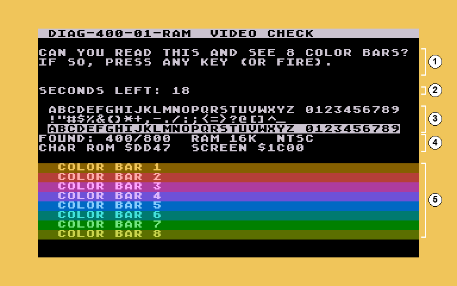

1. The question. If you can read it and see eight colour bars, press any
   key (or START, SELECT, OPTION or fire).
2. Seconds left. With no answer the border turns purple, a siren sounds for
   a moment and a 10 s last chance starts. Without an answer the test goes
   on anyway, and the results say "video not confirmed".
3. The whole character set, normal and inverse.
4. The machine type, the RAM found, PAL or NTSC, and a checksum of the
   character ROM.
5. The eight colour bars.

**Testing.** Each 16K bank is tested in turn; the screen says which. On a
machine with a lot of RAM this takes a few minutes.

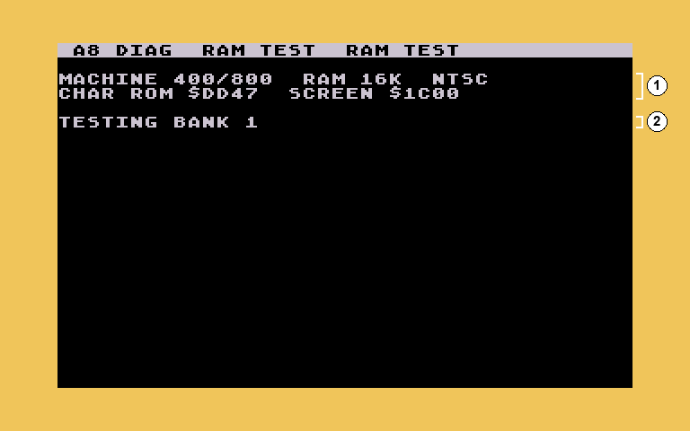

1. The machine and the RAM found.
2. The bank being tested now.

**Result.**

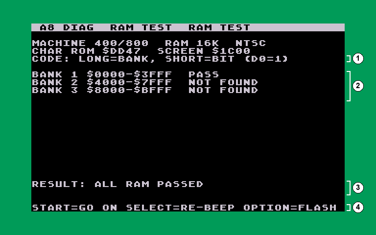

1. How to read the code.
2. One line per 16K bank: PASS, FAIL, or NOT FOUND (no RAM there).
3. The overall result, and whether you confirmed the video.
4. The keys (see [Keys during a result](#keys-during-a-result)).

When a bank fails, its line says FAIL and lists the bad data bits (for
example `BITS D4`), and the border goes red while the code plays. On an
800XL each data bit is one RAM chip; see
[When something fails](#when-something-fails).

**Summary** (machines with 16K or more). The second part of the tape tests
the RAM the first part ran in, then on an XL/XE the RAM under the operating
system and, on a 130XE, the four extra banks. Then it shows everything:

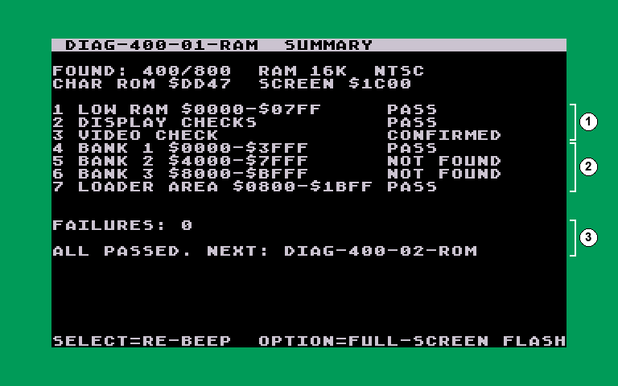

1. Low RAM, the display checks and the video check.
2. Every bank, the area the first part ran in, the RAM under the OS (XL/XE)
   and the 130XE banks.
3. The number of failures and what to do next.

### ROMs (`diag-400-02-rom`; test 1 in the system tapes)

The test reads every ROM chip and works out its CRC32 checksum, then looks
it up in a table of known Atari ROMs.

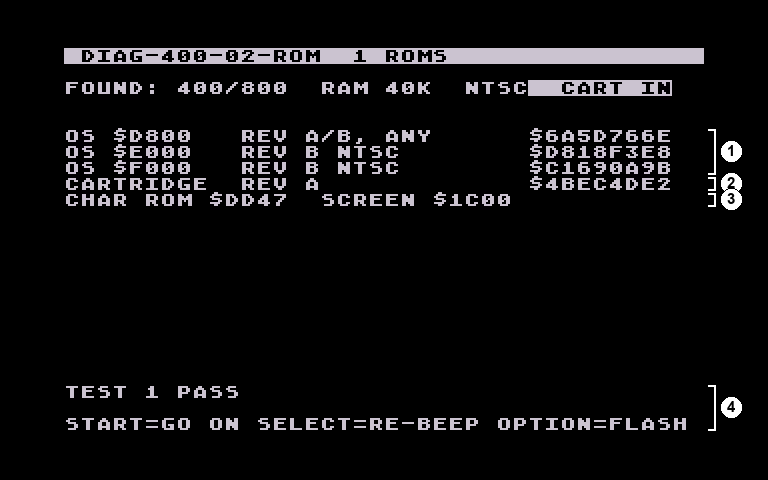

1. The 400/800's three OS chips, each named on its own. A repaired board
   can have chips from different revisions; the test spots that (item 5).
2. A cartridge, if one is plugged in (here BASIC rev A). "NONE" is not a
   fault.
3. The character set's checksum.
4. Where the names come from.
5. The result.

On an XL/XE the OS is one 16K chip, named as a whole:

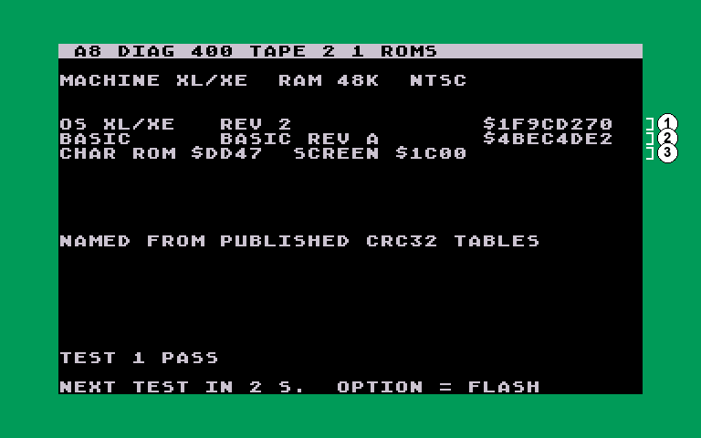

1. The OS. `UNKNOWN` (in inverse) means it matches no Atari ROM in the
   table: a patched, replacement, failing or badly seated chip.
2. BASIC, built into the XL/XE. A BASIC or cartridge the table doesn't know
   shows "NOT IN THE TABLE" and is not a fault.
3. The character set's checksum.

Items: 1 the OS reads differently twice; 2 BASIC or the cartridge reads
differently twice; 3 an unknown OS; 4 the character set reads differently
twice; 5 OS chips from different revisions.

### Keyboard and console keys (`diag-400-03-input`; tests 2 and 3)

**Keyboard.** Press every key. Each key on the map shows one of three
states, without needing colour, so this works on a black-and-white screen
too:

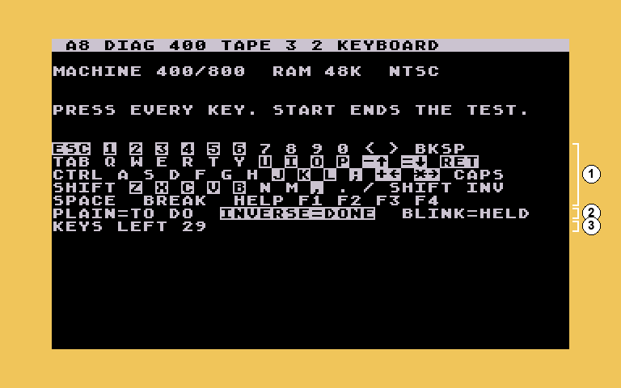

1. The key map. Not pressed yet: normal. Done: inverse. Held down now:
   inverse, blinking. The four arrow keys are
   CONTROL with `-` `=` `+` `*`, so those keys carry the arrows. CONTROL
   lights only together with another key: the Atari can't see CONTROL on
   its own.
2. The legend.
3. How many keys are left. HELP and F1-F4 (XL/1200XL) show but aren't
   required.

Press START when you're done. If keys are missing, the result screen shows
the pressed keys in inverse, so the missing ones stand out:

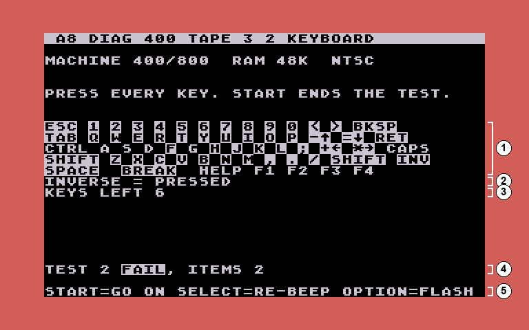

1. The map: inverse = pressed, normal = never pressed.
2. The legend for this screen.
3. Keys left.
4. The result and the failed items (item 1: a key was already held at the
   start, a stuck key; item 2: keys never pressed).
5. The keys.

**Console keys.** Press START, SELECT and OPTION. Then the console speaker
plays a tone over and over until you answer.

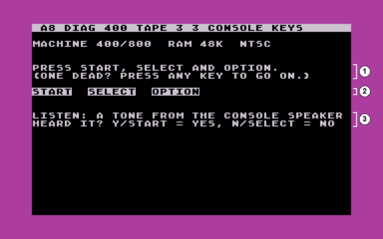

1. What to do. If one of the three keys is dead, any keyboard key moves on
   (and that key is marked failed).
2. The keys seen so far, in inverse.
3. The question about the speaker, answered with Y or START (yes) or N or
   SELECT (no). The border is purple while it waits.

### Joysticks and paddles (`diag-400-04-ports`; tests 5 and 6)

**Joysticks.** Move each joystick and press its button. Each direction and
the button show inverse while active. START (or any key) ends the test.

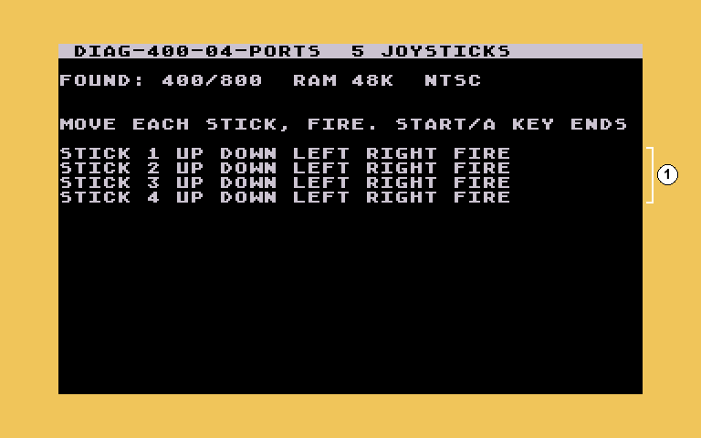

1. One line per port: four on a 400/800, two on an XL/XE. Something
   already active at the start counts as stuck (item = port).

**Paddles.** First, unplug all paddles and press START: with nothing
plugged in, every paddle input must read 228 (SELECT skips this check).
Then plug the paddles back in and turn each one:

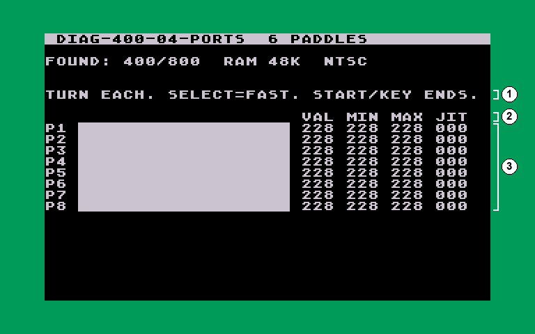

1. What to do. SELECT switches the fast scan on and off.
2. The column headings: value now, lowest and highest seen (a full turn
   reaches about 1 and 228), and jitter.
3. One line per paddle, with a bar. Jitter is how much the value wobbles
   with the knob still: a large jitter means a dirty or worn paddle. A `T`
   at the end means the paddle's button is pressed.

### Sound and video (`diag-400-05-av`; tests 4 and 7)

**POKEY.** The sound chip's timer and random-number generator are checked
automatically. Then each of its four voices plays, one at a time, over and
over until you answer whether you heard it.

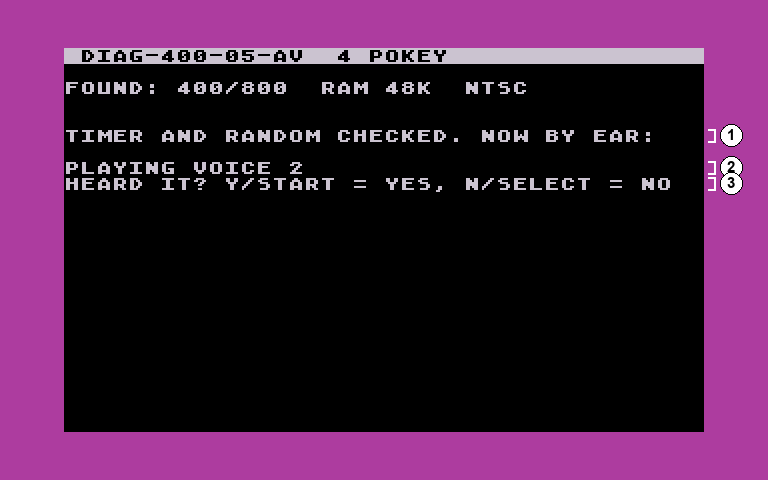

1. The automatic checks are done.
2. The voice playing now.
3. The question: Y or START = yes, N or SELECT = no.

**GTIA.** First, eight brightness steps and sixteen colours, drawn down the
screen (item 1). Then the sprites (item 2): the word ATARI, made of the four
players and the four missiles, scrolls across the screen in rainbow colours
that move down the letters. Answer whether it looks right.

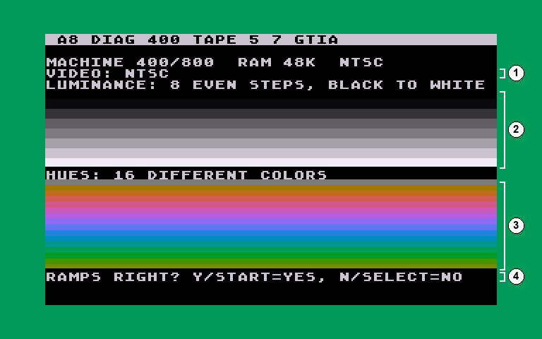

1. PAL or NTSC, as the machine reports it.
2. Eight even steps from black to white.
3. Sixteen different colours.
4. The question: do they look right?

### The menu (`diag-16k-02-system` and `diag-48k-xl-xe`)

On machines with 16K or more, all seven tests are on one tape with a menu.

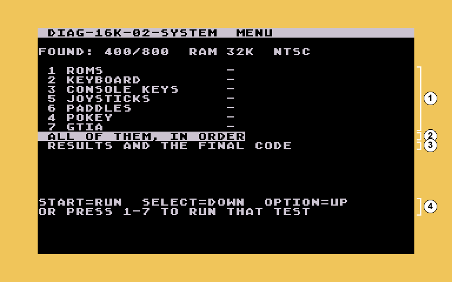

1. The tests, with their state: `-` not run yet, PASS, or FAIL and the
   failed items.
2. "ALL OF THEM, IN ORDER", highlighted when the menu first appears: one
   press of START runs everything.
3. The results and the final code.
4. The keys: START runs the highlighted line, SELECT moves down, OPTION
   moves up, and 1-7 run that test. After a test the next one is
   highlighted, so pressing START again and again goes through them all.

Running a test again replaces its old result.

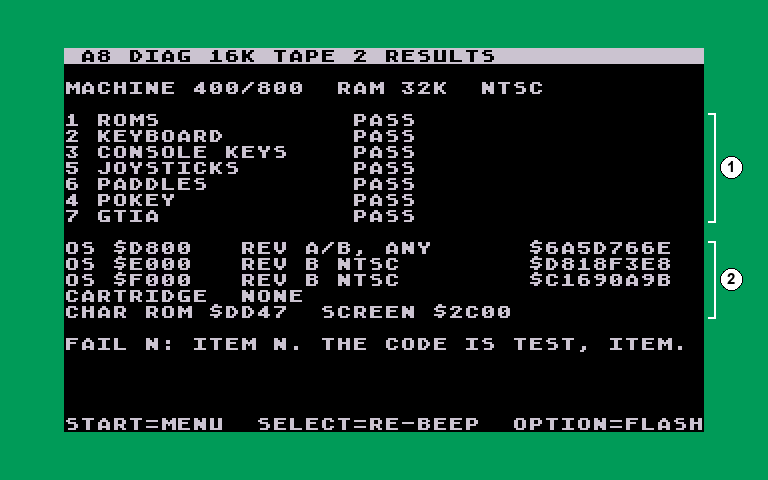

1. Every test: PASS, FAIL and its items, or `-` if not run.
2. The ROMs (see [ROMs](#roms-diag-400-02-rom-test-1-in-the-system-tapes)).

### The 48K and XL/XE tape (`diag-48k-xl-xe`)

One tape, one load. It tests the RAM in two steps (first everywhere except
where it loaded, then, from the RAM it has just proven, the area it loaded
into), then the RAM under the OS and the 130XE banks, then the seven tests
with the menu.

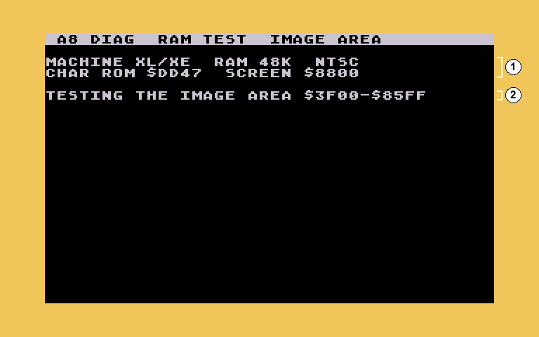

At the end, RAM faults show up again as test 8, with the bank as the item:

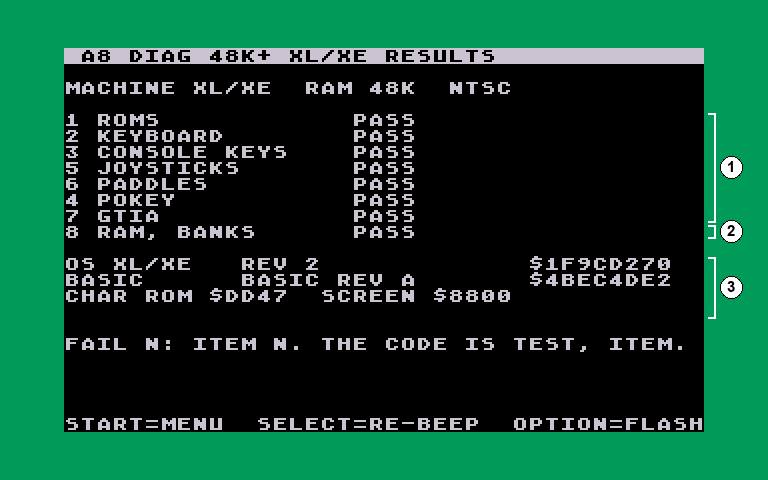

1. The seven tests.
2. Test 8: the RAM. FAIL with the bank numbers if any RAM failed; the code
   plays them as long ×8, then short × bank.
3. The ROMs: here a real XL OS rev 2 and BASIC rev A.

### Burn-in (`diag-burnin`, `diag-400-burnin`)

The burn-in repeats the RAM tests until you press a key: leave it running
for an hour or a day to catch faults that only show when the machine is
warm. It keeps a clock, counts passes, and logs every bad bit: in which
pass it first failed, and in how many passes since. A bit that failed every
time is **solid**; one that only fails sometimes is **intermittent**.

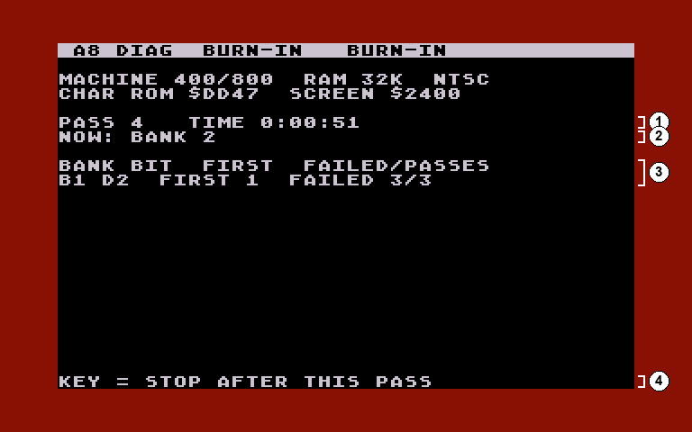

1. The pass number and how long it has run.
2. What it's testing now.
3. The log: bank (B1-B8; B9 is the burn-in's own RAM on the 400 version),
   bit, the first pass it failed in, and failed/passes.
4. Press a key to stop after the pass in progress.

The border shows the state so far: green no errors, red solid errors only,
yellow if anything intermittent has been seen.

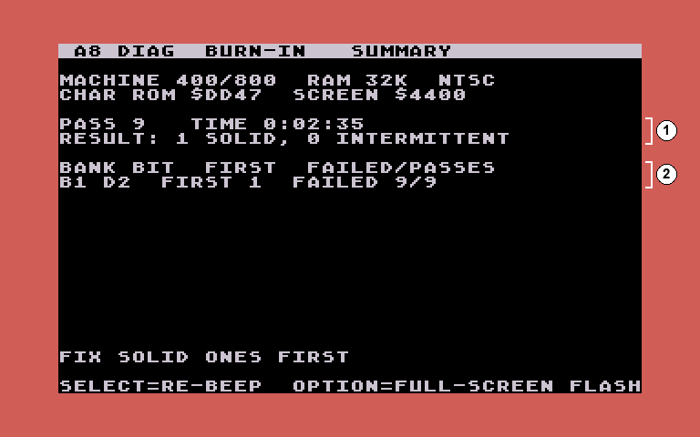

1. Passes, time and the result.
2. The log.

The burn-in also tests the RAM it runs in:
- **`diag-400-burnin`:** each page of its own code is moved aside, tested
  and put back, every pass. While that happens the top of the screen shows
  the page being worked on, as a jumble of characters.
- **`diag-burnin`:** on 32K and up it keeps two copies of itself that take
  turns, each testing the other's RAM. So the RAM it sits in gets the same
  full test as all the rest.

Every pass, both burn-ins also test the screen's own RAM where you can see
it: an inverse bar runs down the screen, one row at a time. Each row is
inverted, held for two frames, checked, put back and checked again.

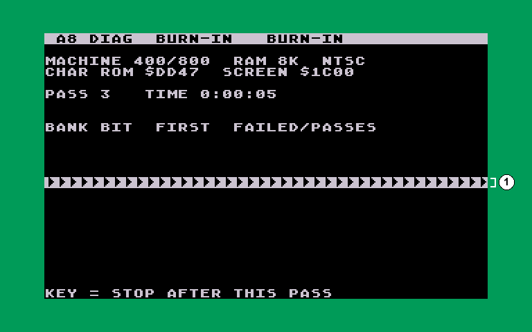

1. The row being tested. A blank row shows as a row of arrows: that's what
   a space looks like with every bit flipped.

## When something fails

- **Note the code** (or the screen). Long beeps say where, short beeps say
  which bit or item.
- **RAM:** a bad bit in one bank usually means one RAM chip. On an 800XL
  each data bit (D0-D7) is one chip, across all of the 64K. On a 400/800
  each 16K board has its own chips, so the bank tells you which board. The
  same bad bit in every bank points at something shared: a data line, a
  socket, or a buffer chip.
- **Run the burn-in** on a machine that passes but misbehaves, or after a
  repair. Intermittent faults often only show when the machine is warm.
- **Fall back to the 400 set** when a machine can't get through its own
  tapes. It only needs the first 8K of RAM. In particular:
  - no green chirp after loading: the RAM the tape loaded into is bad
  - one long beep then the low beep, with no picture: the tape didn't load
    into RAM correctly
  - `BANK 1 BAD: USE THE 400 SET`
- **A tape that won't load at all**, or a BOOT ERROR, also points at the
  first part of RAM, or the cassette or SIO connection.

## Questions

### Why the different sets?

So that a tape never needs more RAM than the machine has, and bigger
machines load in fewer steps. The 400 set works on everything, which is why
it's the fallback.

### Is this a substitute for a burn-in?

No. The RAM tapes test every byte with strong patterns, but only once. A
fault that only shows when warm, or now and then, needs the burn-in running
for a while.
